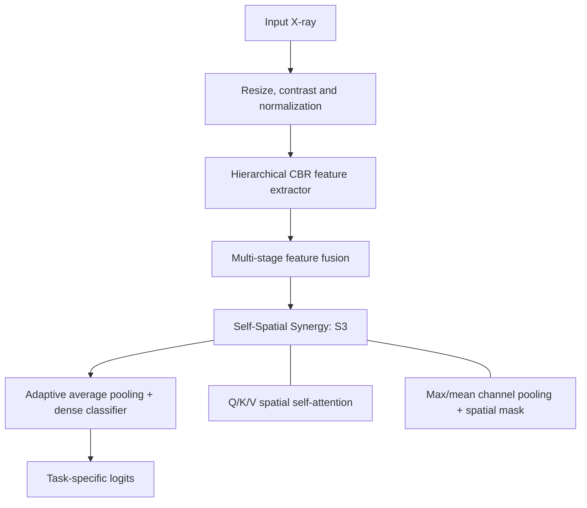

[CXRNet_README.md](https://github.com/user-attachments/files/34964873/CXRNet_README.md)
<div align="center">

# CXR-Net Research Kit

**A modular, reproducibility-oriented PyTorch implementation of multi-domain X-ray classification with Self-Spatial Synergy (S3) attention.**

`PyTorch` · `Medical Imaging` · `Multi-domain Learning` · `S3 Attention` · `Leakage-aware Evaluation`

[Quick start](#quick-start) · [Architecture](#architecture) · [Datasets](#datasets-and-data-splitting) · [Training](#training-workflows) · [Evaluation](#evaluation-and-interpretability) · [Paper fidelity](#paper-fidelity-and-engineering-decisions)

**[English documentation](README.md) | [راهنمای فارسی](README_FA.md)**

</div>

> [!IMPORTANT]
> **Research implementation, not the authors' verified original code.** This project interprets and extends the published CXR-Net architecture. Several architectural and training details are unspecified or inconsistent in the paper; those decisions are documented rather than presented as exact reproduction. **The paper's reported accuracies have not been reproduced or verified by this repository.**

> [!CAUTION]
> **Not a medical device.** This software, its predictions, confidence scores and Grad-CAM visualizations are for research and software development only—not clinical diagnosis or patient-care decisions.

## Overview

The toolkit implements a **shared CNN feature extractor**, **hierarchical CBR blocks with feature fusion**, and **S3 attention** combining global self-attention with channel-pooled spatial attention. It supports three separate classification tasks and a two-stage experiment: multi-domain pretraining followed by task-specific fine-tuning.

| Research task | Output labels | Classes |
|---|---|---:|
| Chest X-ray | `normal`, `bacterial_pneumonia`, `viral_pneumonia` | 3 |
| Multi-region bone X-ray | `fractured`, `not_fractured` | 2 |
| Shoulder X-ray | `a1`, `c1`, `d1`, `others` | 4 |

The **original paper** reports **99.82%**, **100.00%**, and **97.53%** accuracy for these tasks in its Table 4, respectively. These are *publication claims*, **not benchmark results of this implementation**. Its Table 6 reports different figures; the difference in evaluation protocols is not fully explained. See [paper-to-code traceability](docs/PAPER_MAPPING.md).

### What is included

- **Data integrity:** dataset indexing, label validation, optional patient-ID grouping, stratified splitting, original-split preservation and exact-byte duplicate checks.
- **Medical-image preparation:** resizing, normalization, contrast factors, histogram equalization, optional CLAHE, and **training-only** geometric augmentation and balanced sampling.
- **Model components:** CBR stages, hierarchical concatenation/summation, self-attention, spatial attention, two selectable S3 fusion formulations, and classification heads.
- **Training:** scratch baseline, shared-backbone multi-domain pretraining, task-specific fine-tuning, validation-selected checkpoints and early stopping.
- **Analysis:** sample-level classification metrics, confidence intervals, confusion matrices, CSV predictions, Grad-CAM, inference, attention ablations, contrast sweeps and complexity benchmarking.
- **Reproducibility:** YAML configurations, checkpoint metadata, run artifacts, unit tests and a synthetic end-to-end integration test.

## Architecture



**CBR** denotes `Conv2d → BatchNorm2d → ReLU`. Hierarchical skip/feature fusion occurs across CBR stages. The **S3** block is available in two explicitly documented variants:

| Setting | Behavior | Relationship to paper |
|---|---|---|
| `model.s3_fusion: algorithm` **(default)** | Adds self-attended and spatially attended features | Closest to **Algorithm 1**, page 10 |
| `model.s3_fusion: diagram` | Concatenates both branches, followed by `Conv2d + SiLU` | Engineering interpretation of **Figure 4**, page 9 |

`model.attention` can be `none`, `self`, `spatial`, or `s3`. By default the implementation uses **four attention heads**, whereas the paper's pseudocode is closer to single-head scaled dot-product attention. Configure `attention_heads: 1` for a closer algorithmic interpretation. Read [design decisions](docs/DESIGN_DECISIONS.md) before changing architecture settings.

## Quick start

**Requirements:** Python **3.10+**, PyTorch **2.2+**, and a supported CPU, NVIDIA GPU or Apple Silicon environment. For CUDA, install the appropriate PyTorch build for your hardware first from the [official PyTorch instructions](https://pytorch.org/get-started/locally/).

```bash
# 1. From the repository root
python -m venv .venv

# 2. Activate the environment
source .venv/bin/activate             # Linux / macOS
# .venv\Scripts\Activate.ps1         # Windows PowerShell

# 3. Install the toolkit and test tools
python -m pip install -e ".[test]"

# 4. Verify the installation
python -m pytest -q
python -m cxrnet --help
```

**Fast CPU smoke test**, using **synthetic patterns, not radiographs**:

```bash
python scripts/create_synthetic_data.py --output data/raw --per-class 16
python -m cxrnet --config configs/quick_cpu.yaml index
python -m cxrnet --config configs/quick_cpu.yaml split
python -m cxrnet --config configs/quick_cpu.yaml audit
python -m cxrnet --config configs/quick_cpu.yaml pretrain --epochs 1
python -m cxrnet --config configs/quick_cpu.yaml finetune --domain chest --epochs 1 --checkpoint runs/quick_cpu/pretraining/best.pt
```

> Synthetic data only checks whether the software pipeline runs. **No metric obtained from this demonstration is a scientific, clinical or paper-reproduction result.** Use a fresh `data/raw` directory for real datasets; never mix synthetic and clinical images.

All commands below accept either `python -m cxrnet` (portable) or the installed `cxrnet` executable. Global options such as `--config` and `--device` must appear **before** the subcommand.

## Datasets and data splitting

**Raw data are intentionally not included.** Obtain the datasets independently, verify licenses/label definitions, and retain source provenance. The paper refers to Kermany et al. (Chest X-ray), Rodrigo (multi-region fractures), and Yari (shoulder classifications).

Expected **unsplit** directory layout:

```text
data/raw/
├── chest/
│   ├── normal/
│   ├── bacterial_pneumonia/
│   └── viral_pneumonia/
├── fracture/
│   ├── fractured/
│   └── not_fractured/
└── shoulder/
    ├── a1/
    ├── c1/
    ├── d1/
    └── others/
```

Put `.jpg`, `.jpeg`, `.png`, `.bmp`, `.tif`, or `.tiff` images inside the corresponding class folders. The input loader uses PIL/8-bit converted images; clinical DICOM or high-bit-depth modalities require a separately validated import/windowing workflow.

Pre-existing partitions are also supported: `data/raw/chest/train/normal/...`, `.../val/normal/...`, `.../test/normal/...`. Existing complete splits are preserved by default (`respect_existing_splits: true`). Labels and folder names must match [`configs/default.yaml`](configs/default.yaml).

### Patient-aware preparation (strongly recommended)

If reliable patient identifiers are available, create a CSV **relative to `data/raw`**:

```csv
path,patient_id
chest/normal/p001_scan1.jpg,SITEA_P001
chest/normal/p001_scan2.jpg,SITEA_P001
chest/viral_pneumonia/p002.jpg,SITEA_P002
```

Set `data.split.require_patient_ids: true` (or start from [`configs/patient_ids_required.yaml`](configs/patient_ids_required.yaml)) and run:

```bash
python -m cxrnet --config configs/default.yaml index --patient-map patient_ids.csv
python -m cxrnet --config configs/default.yaml split
python -m cxrnet --config configs/default.yaml audit
```

The default target is **70% train / 20% validation / 10% test**. Grouped splitting may produce approximate image fractions when patients contribute unequal numbers of studies. If patient identifiers are unavailable, the tool can stratify by **image** with a warning, but **cannot guarantee patient independence**. Hash checks identify identical bytes, not visually similar or transformed duplicates. Do not invent patient IDs from arbitrary filenames.

**Leakage safeguards:** splitting occurs **before** online augmentation; class balancing uses only training images; multi-domain pretraining uses only training partitions; model/preprocessing selection uses validation, not test data. See the [data protocol](docs/DATA_PREPARATION.md).

## Training workflows

Use [`configs/default.yaml`](configs/default.yaml) as the starting point. The defaults are **engineering choices**, not author-confirmed hyperparameters.

### A. Multi-domain pretraining

Train one backbone with **three separate domain classification heads**. Training images only are used for weight updates; validation determines the best checkpoint.

```bash
python -m cxrnet --config configs/default.yaml pretrain --epochs 200
# Output: runs/default/pretraining/best.pt
```

To pretrain on a subset: `pretrain --domains chest fracture --epochs 200`. Task-specific heads avoid treating the three datasets as an artificial nine-class common labeling task.

### B. Task-specific fine-tuning

```bash
python -m cxrnet --config configs/default.yaml finetune --domain chest --checkpoint runs/default/pretraining/best.pt --epochs 100
python -m cxrnet --config configs/default.yaml finetune --domain fracture --checkpoint runs/default/pretraining/best.pt --epochs 100
python -m cxrnet --config configs/default.yaml finetune --domain shoulder --checkpoint runs/default/pretraining/best.pt --epochs 100
```

Outputs: `runs/default/finetune_chest/`, `finetune_fracture/`, and `finetune_shoulder/`. By default, each fine-tuning run selects its best checkpoint on validation and **then evaluates its test split**. Avoid repeating this evaluation while choosing methods; for confirmatory claims, maintain an additional independent holdout.

To reinitialize a task head: add `--reset-head`. For a **no-pretraining baseline**:

```bash
python -m cxrnet --config configs/default.yaml train --domain chest --epochs 100
# Output: runs/default/scratch_chest/best.pt
```

### C. Configuration essentials

| YAML key | Default | Purpose |
|---|---|---|
| `seed` | `42` | Experiment seed |
| `data.image_size` | `224` | Square input resolution |
| `data.contrast_method` / `contrast_factor` | `factor` / `1.4` | Contrast transform |
| `data.split.require_patient_ids` | `false` | Raise an error if patient IDs are missing |
| `model.channels` | `[32,64,96,128,160]` | CNN stage widths |
| `model.fusion` | `concat` | Backbone feature fusion |
| `model.attention` / `model.s3_fusion` | `s3` / `algorithm` | Attention and S3 variant |
| `model.attention_heads` | `4` | Multi-head global attention |
| `model.attention_max_tokens` | `1024` | Upper bound on spatial tokens |
| `train.batch_size` | `16` | Batch size |
| `train.optimizer` / `learning_rate` | `adamw` / `0.0003` | Optimization |
| `train.balancing` | `epoch_balanced` | Train-only class sampling |
| `train.monitor` | `val_loss` | Checkpoint selection |

Keep the **model architecture, channel layout, class order and input preprocessing** consistent when loading checkpoints; loader validation rejects mismatches.

## Evaluation and interpretability

**Evaluate** a saved task-specific checkpoint:

```bash
python -m cxrnet --config configs/default.yaml evaluate --domain chest --checkpoint runs/default/finetune_chest/best.pt
```

The reporting module includes **accuracy**, balanced accuracy, macro precision/recall/F1, weighted F1, per-class sensitivity/specificity, confusion counts, ROC AUC (when defined), cross-entropy, expected calibration error and approximate Wilson confidence intervals. These intervals assume independent image observations; patient-clustered data require a different inference procedure. All aggregate classification metrics use **sample-level predictions**, not an average of batch scores.

**Run single-image inference** (uses the dataset's configured preprocessing):

```bash
python -m cxrnet --config configs/default.yaml predict --domain chest --checkpoint runs/default/finetune_chest/best.pt --image /path/to/image.jpg
```

**Create a Grad-CAM overlay**:

```bash
python -m cxrnet --config configs/default.yaml gradcam --domain chest --checkpoint runs/default/finetune_chest/best.pt --image /path/to/image.jpg --output runs/chest_gradcam.png
```

Grad-CAM highlights model sensitivity and does **not** establish that a heatmap is a clinically correct localization, a causal explanation, or pathology segmentation.

**Measure complexity and runtime**:

```bash
python -m cxrnet --config configs/default.yaml benchmark --domain chest --batch-size 1
```

`benchmark` profiles a model **constructed from the current configuration** (not a checkpoint-loaded trained model). It reports parameters, timing and device-dependent memory where available. FLOPs are not reported because this project does not bundle a validated FLOPs profiler.

### Controlled experiments: ablations and contrast

```bash
# Compare four attention variants; select using VALIDATION results only.
python -m cxrnet --config configs/default.yaml ablate --domain chest --epochs 30 --modes none self spatial s3

# Compare manuscript-motivated enhancement alternatives, again on VALIDATION.
python -m cxrnet --config configs/default.yaml contrast-sweep --domain chest --epochs 30 --methods equalize factor_1.2 factor_1.4 factor_1.6
```

For CLAHE support: `python -m pip install -e ".[clahe]"` and add `clahe` to the contrast methods. `factor_1.4` is a **PIL-specific reproducible interpretation** of the paper's unspecified “40% contrast enhancement,” not proof that the authors used the identical operation. Ablation and contrast-sweep commands save validation comparisons and **do not access the test split**.

### Run artifacts

A typical `runs/default/finetune_chest/` directory contains:

```text
finetune_chest/
├── best.pt                     # Validation-selected checkpoint
├── resolved_config.yaml        # Frozen effective configuration
├── history.csv
├── history.json
├── loss.png
├── summary.json
├── test_metrics.json
├── test_predictions.csv         # Image-level predictions and probabilities
└── test_confusion_matrix.png
```

Pretraining saves its own `best.pt`, history, validation-by-domain report and summary. Ablation/contrast sweeps create per-variant directories and a `validation_comparison.csv`. The CLI `audit` saves `runs/default/data_audit.json`.

## Repository layout

```text
CXRNet-Research-Kit/
├── cxrnet/
│   ├── cli.py                     # Unified command-line interface
│   ├── config.py                  # YAML loading and validation
│   ├── data/
│   │   ├── manifest.py            # Image indexing and patient mapping
│   │   ├── splitting.py           # Protected dataset partitions
│   │   ├── audit.py               # Duplicate/overlap checks
│   │   ├── transforms.py          # Enhancement and train transforms
│   │   ├── balancing.py           # Train-only balanced sampling
│   │   └── datasets.py            # PyTorch Dataset/DataLoader
│   ├── model/
│   │   ├── blocks.py              # CBR and feature fusion
│   │   ├── attention.py           # QKV, spatial and S3 attention
│   │   ├── backbone.py            # CNN feature extractor
│   │   ├── classifier.py          # Prediction head
│   │   └── network.py             # Single- and multi-task models
│   ├── training/
│   │   ├── optimizer.py           # Losses, optimizers, schedulers
│   │   ├── engine.py              # Epoch execution and validation
│   │   ├── stages.py              # Pretrain/train/fine-tune workflows
│   │   └── checkpoints.py         # Model state and metadata
│   └── evaluation/
│       ├── metrics.py             # Classification and calibration metrics
│       ├── plots.py               # Confusion matrix and learning curves
│       ├── inference.py           # Single-image inference
│       ├── explain.py             # Grad-CAM
│       ├── benchmark.py           # Runtime and parameter profiling
│       ├── ablations.py           # S3 component comparisons
│       └── contrast_sweep.py      # Preprocessing comparisons
├── configs/                       # Default, CPU and alternate settings
├── docs/                          # Protocol, paper mapping, decisions
├── scripts/                       # Synthetic test data generator
├── tests/                         # Unit and integration tests
├── pyproject.toml
├── README_FA.md
└── LICENSE
```

## Paper fidelity and engineering decisions

This toolkit separates **source-supported design** from **implementation assumptions**:

| Topic | What the paper supports | What this implementation chooses |
|---|---|---|
| S3 attention | QKV + spatial pooling and attention fusion | Both additive Algorithm 1 and Conv-based Figure 4 interpretation |
| CNN backbone | CBR with multi-stage concatenation | Explicit stage widths, `3×3` convolutions, projections and downsampling |
| Classification head | Dense classifier, average pooling, dropout, softmax | Adaptive pooling → flatten → 3 linear layers; raw logits during training |
| Pretraining | Joint exposure to three X-ray domains | Shared feature extractor plus **domain-specific** heads; train-only data |
| Image contrast | Best reported performance at “40% contrast” | PIL `ImageEnhance.Contrast(...).enhance(1.4)` |
| Data balancing | Augmented chest and shoulder images | Training-only augmentation and balanced epoch sampling |
| Evaluation | 70/20/10 split and reported accuracies | Patient-aware split where identifiers exist; validation-only model selection |

**Important unresolved issues:** exact author hyperparameters and layers are not fully reported; Figure 4 and Algorithm 1 specify different attention fusion paths; original preprocessing math is missing; source-paper pretraining/test separation is ambiguous; and reported results in Tables 4 and 6 differ. The repository does **not** invent answers or claim those uncertainties are resolved. Consult:

- [`docs/PAPER_MAPPING.md`](docs/PAPER_MAPPING.md) — manuscript section/figure → code module.
- [`docs/DESIGN_DECISIONS.md`](docs/DESIGN_DECISIONS.md) — architectural assumptions and differences.
- [`docs/DATA_PREPARATION.md`](docs/DATA_PREPARATION.md) — source integrity, grouping and transformations.
- [`docs/RESEARCH_CHECKLIST.md`](docs/RESEARCH_CHECKLIST.md) — pre-publication quality checks.

## Tests and reproducibility

```bash
python -m pytest -q                 # Unit tests
python -m pytest -q -m integration  # Synthetic end-to-end integration test
python -m pytest -q -m ""           # All tests
```

The bundled [`QA_REPORT.json`](QA_REPORT.json) records **21 unit tests, 1 integration test**, and smoke tests for 11 CLI commands on synthetic data at package creation. These are **software checks only**; they do not substantiate clinical performance. Results can differ with environment and installed dependency versions. For research reporting, record data source versions, patient/site partitions, exact seed, config, package versions, checkpoint hashes, per-class metrics, and independent-site testing.

## Limitations

- **No real-image datasets, pretrained clinical checkpoints, or original author source code** are distributed.
- **No verified reproduction** of the publication's reported accuracy or cross-domain transfer claims.
- Patient independence depends on **accurate patient metadata**; SHA256 catches only byte-identical duplicates.
- Binary/multiclass **single-label** tasks only; multi-label disease coexistence is not implemented.
- Grad-CAM and model confidence are **not** calibrated explanations of disease location or clinical certainty.
- Full spatial self-attention has approximately **quadratic memory complexity** in the number of image tokens; an explicit token guard prevents accidental excessive allocations.

## Paper, citation and license

**Reference paper:** Raeisi, Z., Rokhva, S., Roshanzamir, A., & Ahmadi Lashaki, R. (2025). *An accurate attention based method for multi-tasking X-ray classification*. **Multimedia Tools and Applications**. [https://doi.org/10.1007/s11042-025-21105-5](https://doi.org/10.1007/s11042-025-21105-5).

```bibtex
@article{raeisi2025cxrnet,
  title   = {An accurate attention based method for multi-tasking X-ray classification},
  author  = {Raeisi, Zahra and Rokhva, Shayan and Roshanzamir, Amirsadegh and Ahmadi Lashaki, Reza},
  journal = {Multimedia Tools and Applications},
  year    = {2025},
  doi     = {10.1007/s11042-025-21105-5}
}
```

**License:** MIT for the *newly written toolkit code*; see [`LICENSE`](LICENSE). This does **not** license the original article, figures, datasets or third-party material. This project is independent and not an official Springer Nature or author-maintained implementation.
