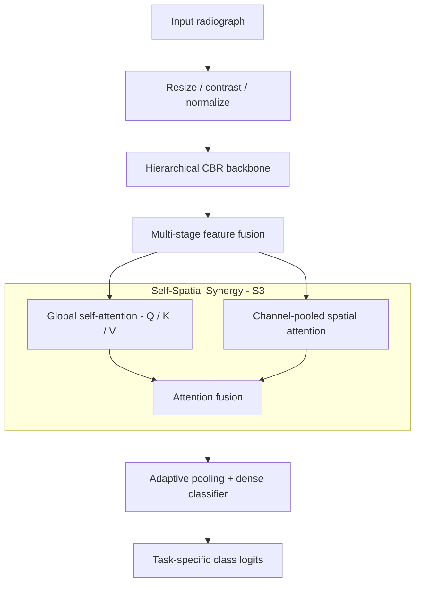

[CXRNet_README.md](https://github.com/user-attachments/files/34965340/CXRNet_README.md)
<div align="center">

# CXR-Net
### Multi-domain X-ray classification with Self-Spatial Synergy attention

**A modular PyTorch implementation for studying convolutional feature fusion, global–spatial attention, and transfer learning across radiographic classification tasks.**
</div>

---

## Overview

CXR-Net combines a hierarchical convolutional backbone with **Self-Spatial Synergy (S3)** attention to learn image representations from chest, fracture, and shoulder radiographs. The repository provides the model, data pipeline, training procedures, evaluation utilities, and controlled experiments as a cohesive, configurable research package.

Three single-label classification tasks are supported:

| Domain | Classes | Prediction target |
| :--- | :---: | :--- |
| **Chest X-ray** | 3 | Normal · bacterial pneumonia · viral pneumonia |
| **Bone fracture (multi-region)** | 2 | Fractured · not fractured |
| **Shoulder X-ray** | 4 | A1 · C1 · D1 · Others |

### Capabilities

- **Model:** CBR-based feature extraction, hierarchical feature fusion, global self-attention, spatial attention, and configurable S3 fusion.
- **Data:** image indexing, optional patient-grouped splitting, original-split preservation, duplicate audits, contrast transforms, and train-only augmentation/balancing.
- **Training:** shared-backbone multi-domain pretraining, individual task fine-tuning, and from-scratch baselines.
- **Evaluation:** per-image predictions, classification and calibration metrics, confusion matrices, Grad-CAM, and latency/parameter benchmarking.
- **Research:** attention ablations and validation-based contrast comparisons, with YAML configurations and saved checkpoints.

## Model architecture



The **CBR** building block applies `Conv2d → BatchNorm2d → ReLU`. Feature maps from successive stages are fused in the CNN backbone. The S3 module uses two complementary operations:

1. **Global self-attention** builds query, key, and value projections and models relationships between spatial positions.
2. **Spatial attention** pools along the channel axis, forms a spatial mask, and reweights the feature map.

The publication's **Algorithm 1** and **Figure 4** describe different fusion operations. Both are available rather than silently treating them as identical:

| `model.s3_fusion` | Implementation | Source interpretation |
| :--- | :--- | :--- |
| `algorithm` *(default)* | Addition of self-attended and spatially weighted features | Algorithm 1 |
| `diagram` | Concatenation followed by `Conv2d + SiLU` | Figure 4 |

For isolated component comparisons, set `model.attention` to `none`, `self`, `spatial`, or `s3`. The default model uses four attention heads; `attention_heads: 1` is closer to the paper's single-head pseudocode. Architecture specifications and assumptions are documented in [Design Decisions](docs/DESIGN_DECISIONS.md).

## Getting started

**Prerequisites:** Python 3.10+, PyTorch 2.2+, and a CPU or supported accelerator. Install a CUDA-enabled PyTorch build appropriate for your system when using NVIDIA GPUs (see [PyTorch installation](https://pytorch.org/get-started/locally/)).

```bash
# Run from the repository root.
python -m venv .venv
source .venv/bin/activate            # Linux / macOS
# Windows PowerShell: .venv\Scripts\Activate.ps1

python -m pip install -e ".[test]"
python -m cxrnet --help
python -m pytest -q
```

### End-to-end smoke test

The repository includes a synthetic-image generator to check that indexing, splitting, training, and checkpoint loading work without downloading medical datasets.

```bash
python scripts/create_synthetic_data.py --output data/raw --per-class 16

python -m cxrnet --config configs/quick_cpu.yaml index
python -m cxrnet --config configs/quick_cpu.yaml split
python -m cxrnet --config configs/quick_cpu.yaml audit
python -m cxrnet --config configs/quick_cpu.yaml pretrain --epochs 1
python -m cxrnet --config configs/quick_cpu.yaml finetune \
    --domain chest --epochs 1 \
    --checkpoint runs/quick_cpu/pretraining/best.pt
```

> **Synthetic samples are for software testing only.** Their metrics have no diagnostic or scientific meaning. Remove or relocate `data/raw` before setting up the actual datasets; never combine synthetic and medical images.

## Preparing the datasets

Datasets and trained clinical weights are **not bundled**. Obtain the source datasets referenced in the paper, check their terms of use, and map their labels into the following directory structure:

```text
data/raw/
├── chest/
│   ├── normal/
│   ├── bacterial_pneumonia/
│   └── viral_pneumonia/
├── fracture/
│   ├── fractured/
│   └── not_fractured/
└── shoulder/
    ├── a1/
    ├── c1/
    ├── d1/
    └── others/
```

Place images inside each class directory. Supported image extensions include `.png`, `.jpg`, `.jpeg`, `.bmp`, `.tif`, and `.tiff`. An existing `train/`, `val/`, `test/` folder layer under a domain is also supported and preserved when `respect_existing_splits: true`. The default image loader converts supported images with PIL; DICOM/16-bit clinical workflows require a separately validated conversion process.

```bash
python -m cxrnet --config configs/default.yaml index
python -m cxrnet --config configs/default.yaml split
python -m cxrnet --config configs/default.yaml audit
```

The target split is **70% training / 20% validation / 10% testing**. Splitting is performed before online training augmentation. Balancing and multi-domain weight updates use training partitions only; checkpoint and preprocessing selection use validation data.

**Patient-level separation:** for patient-independent research, provide a CSV containing `path,patient_id`, where `path` is relative to `data/raw`. The CLI argument points to the location of that CSV file:

```csv
path,patient_id
chest/normal/example_001.jpg,SITE_A_001
chest/normal/example_002.jpg,SITE_A_001
```

```bash
python -m cxrnet --config configs/patient_ids_required.yaml \
    index --patient-map /path/to/patient_ids.csv
python -m cxrnet --config configs/patient_ids_required.yaml split
python -m cxrnet --config configs/patient_ids_required.yaml audit
```

Without authentic patient identifiers, the tool can perform image-level stratification, **not guarantee patient independence**. The audit detects byte-identical duplicates but does not detect every near-duplicate, crop, or repeated examination. See [Data Preparation](docs/DATA_PREPARATION.md).

## Training and evaluation

The paper describes pretraining across the three radiographic domains, followed by task-specific retraining. This repository implements that schedule using **one shared backbone and separate classification heads**. That head design is an engineering decision; it is not explicitly established by the paper.

### 1 · Multi-domain pretraining

```bash
python -m cxrnet --config configs/default.yaml pretrain --epochs 200
```

Saves the best validation-selected checkpoint to `runs/default/pretraining/best.pt`. Restrict pretraining to selected domains, if required, with `--domains chest fracture`.

### 2 · Task-specific fine-tuning

```bash
python -m cxrnet --config configs/default.yaml finetune \
    --domain chest --epochs 100 \
    --checkpoint runs/default/pretraining/best.pt

# Other supported domains: fracture, shoulder
```

The selected model is written to `runs/default/finetune_chest/best.pt`. For a from-scratch baseline, use `train --domain chest --epochs 100` rather than `finetune`. Individual train/fine-tune workflows also produce test metrics after selecting their best validation checkpoint; avoid repeatedly using these results to make modeling decisions.

### 3 · Evaluate a checkpoint

```bash
python -m cxrnet --config configs/default.yaml evaluate \
    --domain chest \
    --checkpoint runs/default/finetune_chest/best.pt
```

Reports accuracy, balanced accuracy, macro/weighted classification scores, per-class measures, confusion counts, AUC where defined, and calibration diagnostics. Predictions are aggregated **per image**, not by averaging per-batch scores. The standalone evaluation command writes into `runs/default/evaluation_chest/`.

### 4 · Predict and visualize

```bash
# Classification probabilities for one radiograph
python -m cxrnet --config configs/default.yaml predict \
    --domain chest --image /path/to/xray.jpg \
    --checkpoint runs/default/finetune_chest/best.pt

# Grad-CAM visualization
python -m cxrnet --config configs/default.yaml gradcam \
    --domain chest --image /path/to/xray.jpg \
    --checkpoint runs/default/finetune_chest/best.pt \
    --output runs/chest_gradcam.png
```

Grad-CAM is a qualitative model visualization, **not** a validated lesion localization or clinical explanation.

## Research experiments

These utilities are designed to answer specific architectural questions without tuning against the held-out test set.

```bash
# Is the S3 combination better than either component alone?
python -m cxrnet --config configs/default.yaml ablate \
    --domain chest --epochs 30 --modes none self spatial s3

# Which contrast transform performs best on validation data?
python -m cxrnet --config configs/default.yaml contrast-sweep \
    --domain chest --epochs 30 \
    --methods equalize factor_1.2 factor_1.4 factor_1.6

# Model size, latency and device-dependent memory estimates
python -m cxrnet --config configs/default.yaml benchmark \
    --domain chest --batch-size 1
```

Install `.[clahe]` to add `clahe` to contrast comparisons. The `factor_1.4` transform is implemented with `PIL.ImageEnhance.Contrast`; it is a defined approximation of the paper's “40% contrast” setting, **not a verified match to the authors' preprocessing code**. Benchmarking does not calculate FLOPs and does not load a trained checkpoint.

### Configuration presets

| Configuration | Intended use |
| :--- | :--- |
| [`configs/default.yaml`](configs/default.yaml) | Full research experiments (224×224 input) |
| [`configs/quick_cpu.yaml`](configs/quick_cpu.yaml) | Fast functional checks with a reduced network |
| [`configs/patient_ids_required.yaml`](configs/patient_ids_required.yaml) | Reject datasets without patient identifiers |
| [`configs/s3_diagram.yaml`](configs/s3_diagram.yaml) | Figure-4-inspired S3 fusion |

Key experiment parameters—including backbone widths, attention mode, normalization, optimizer, batch size, and early stopping—are controlled in YAML. Keep model and preprocessing settings consistent with a saved checkpoint.

## Outputs and project structure

Experiment artifacts are saved under the configured `run_dir` (default: `runs/default`). For a fine-tuning run, expect files such as:

```text
runs/default/finetune_chest/
├── best.pt                     # Validation-selected weights and metadata
├── resolved_config.yaml        # Effective experiment settings
├── history.csv                 # Epoch-level training and validation history
├── history.json
├── loss.png
├── summary.json
├── test_metrics.json
├── test_predictions.csv        # Image predictions and class probabilities
└── test_confusion_matrix.png
```

Source code is organized by responsibility:

```text
cxrnet/
├── data/           # Image manifests, splitting, augmentation, loaders, audits
├── model/          # CBR blocks, hierarchical backbone, S3, classifier
├── training/       # Optimizers, checkpoints, training and fine-tuning
├── evaluation/     # Metrics, Grad-CAM, benchmarking and ablations
├── cli.py          # Command-line entry point
└── config.py       # Typed configuration and validation
configs/            # Reproducible experiment presets
docs/               # Paper mapping, assumptions and research protocol
tests/              # Unit and synthetic integration tests
scripts/            # Synthetic data generator
```

See [Paper-to-Code Mapping](docs/PAPER_MAPPING.md) for a component-by-component reference to the manuscript's sections, figures, tables, and pseudocode.

## Reported results and reproducibility

The values below are taken from **Table 4 of the published article**, *not from runs of this software*:

| Task | Accuracy reported in the paper |
| :--- | ---: |
| Chest X-ray | 99.82% |
| Multi-region bone fracture X-ray | 100.00% |
| Shoulder X-ray | 97.53% |

The paper's Table 6 gives different values for the same three domains, without fully clarifying the difference in evaluation protocols. Thus, reproducing the reported scores is an **open empirical question**, not a feature of the released code.

Run software checks with:

```bash
python -m pytest -q                  # Unit tests
python -m pytest -q -m integration   # Synthetic end-to-end test
python -m pytest -q -m ""            # Entire test suite
```

The supplied [`QA_REPORT.json`](QA_REPORT.json) documents 21 passing unit tests, one integration test, and CLI smoke checks against synthetic images when the package was assembled. These checks establish software execution, not medical validity. For publication-grade evaluation, use patient/site-independent data, repeat training across seeds, compare baselines on common partitions, and report class-level uncertainty.
